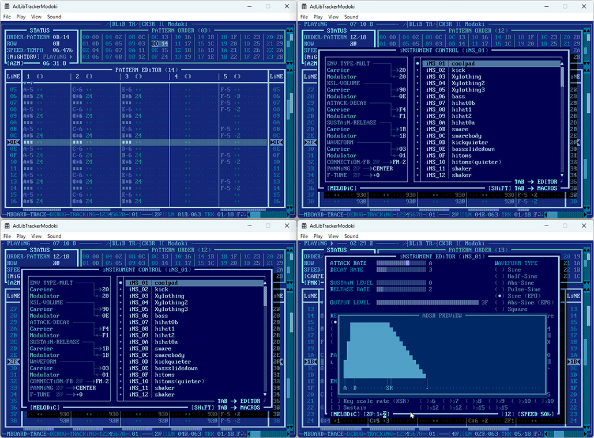
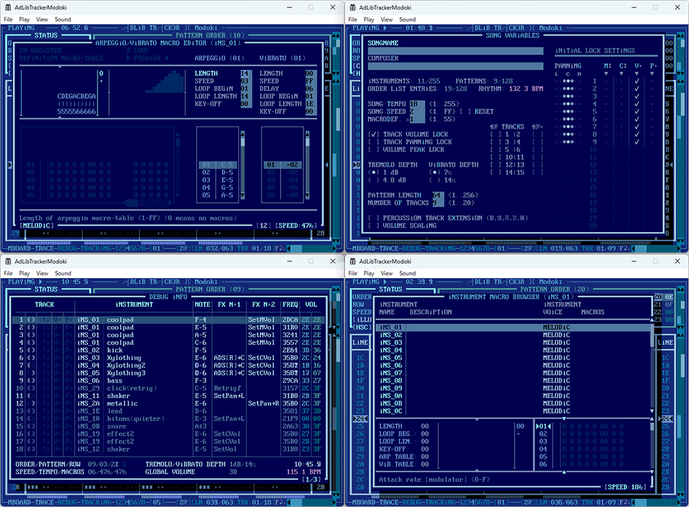

# AdLibTrackerModoki

[日本語](README.ja.md)

A Windows clone of [Adlib Tracker II](http://www.adlibtracker.net/) (AT2), a tracker for the OPL3 (YMF262),
ported from Pascal to C++.

This is a just-for-fun project, not aimed at practical use,
and almost 100% of the code was written by an AI agent (Claude Code Opus 5/5.5).

It reproduces the original's screens and controls as faithfully as possible, while replacing
rendering and audio output with native Windows APIs (Direct2D / DirectSound).

## Features

- The same text-mode screens and key controls as the original (pattern, order, instrument and macro editing, help, etc.)
- Song file loading
  - AT2 formats: A2M / A2T / A2P
  - Other trackers: HSC / RAD / S3M / FMK / DFM / MTK / CFF / AMD / XMS / SAT / SA2
- Song file saving: A2M / A2T / A2P (byte-for-byte identical to the original's output)
- Instrument and instrument bank loading/saving: A2I / A2F / A2B / A2W, plus import from other formats (BNK / CIF / FIB / FIN / IBK / INS / SBI / SGI)
- Selectable sound sources
  - AT2-compatible emulator (a port of opl3emu from the original SDL version; sounds the same as the original)
  - Nuked OPL3 1.8
  - ymfm (YMF262)
  - Real OPL3 hardware (via c86ctl)

### Differences from the original

- A menu bar has been added.
- Opening and saving files uses the standard Windows common dialogs.
- Screen mode (90x40 / 120x50 / 180x60) and sound source are switched from the menu, and the settings are
  saved to `AdLibTrackerModoki.ini` in the same folder as the executable.
- WAV recording is not supported.


## Screenshots





## Requirements

- Windows 10 / 11
- A graphics environment that supports Direct3D 11
- To play on real OPL3 hardware: c86ctl (`c86ctl.dll`) and compatible hardware

## Building

1. Install Visual Studio 2026 (Desktop development with C++, platform toolset v145).
2. Open `src/AdLibTrackerModoki/AdLibTrackerModoki.slnx`.
3. Select a configuration (Debug / Release) and platform (x64, etc.) and build.

All external libraries are bundled in `src/AdLibTrackerModoki/AdLibTrackerModoki/third_party/`,
so no additional installation is required.

## Folder structure

```
src/AdLibTrackerModoki/        Solution and main source code
  AdLibTrackerModoki/
    core/                      Song data, playback engine, OPL3 emulators (OS-independent parts)
    platform/                  Rendering, audio output, key input, hardware drivers (Windows-dependent parts)
    ui/                        Ports of the original's screens and dialogs
    app/                       Settings, sound source switching
    third_party/               Bundled external libraries
  tools/                       Scripts for generating source code
at2-help.md / at2-help.ja.md   Markdown version of the original help and its Japanese translation
original-bugs.md               Bugs in the original found during porting, and how the clone handles them
plan.md                        Development plan and progress
```

## License

Like the original Adlib Tracker II, this software is distributed under the
[GNU General Public License version 3](LICENSE) (or any later version).

This software is a derivative work based on the source code of Adlib Tracker II (subz3ro/Altair).
The screen font, help text, etc. also come from the original.

### Bundled external libraries

| Library | Author | License |
|---|---|---|
| [Nuked OPL3](https://github.com/nukeykt/Nuked-OPL3) 1.8 | Nuke.YKT | LGPL 2.1 or later ([LICENSE](src/AdLibTrackerModoki/AdLibTrackerModoki/third_party/nukedopl3/LICENSE)) |
| [ymfm](https://github.com/aaronsgiles/ymfm) | Aaron Giles | BSD 3-Clause ([LICENSE](src/AdLibTrackerModoki/AdLibTrackerModoki/third_party/ymfm/LICENSE)) |
| c86ctl (headers only) | honet | BSD |

The AT2-compatible emulator is a port of opl3emu.pas (based on Nuked OPL3 1.6) from the original SDL version.
